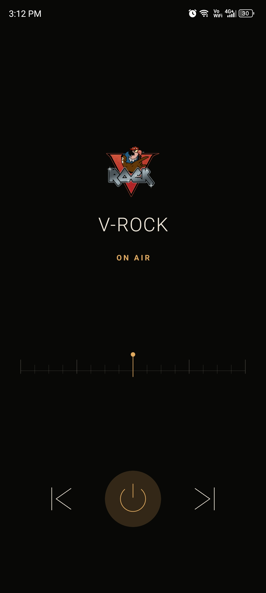
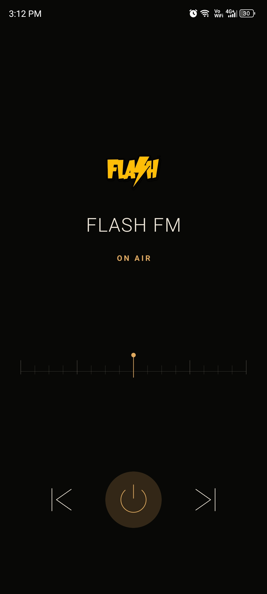

# Vice City Radio

A simple Android radio player inspired by GTA: Vice City.

  
  &nbsp;&nbsp;
  

## Features

- 9 radio stations
- Background playback
- Notification controls
- Offline playback

## Tech Stack

Kotlin · Jetpack Compose · AndroidX Media3 · DataStore

## Download

Get the latest APK from [GitHub Releases](https://github.com/k-artik-k/gta-vc-radio/releases).

## Disclaimer

This is an unofficial fan project. GTA: Vice City and its audio are owned by their respective rights holders. This project is not affiliated with Rockstar Games.

